# Features

The user-facing guide to intervals: every surface, what it does, and how it
works. Product rationale lives in [`SPEC.md`](SPEC.md); system design in
[`ARCHITECTURE.md`](ARCHITECTURE.md). All screenshots live in
[`screenshots/`](screenshots/README.md) — captures come from QA persona runs
against the deployed app, so names and numbers in them are test data.

One rule to keep in mind while reading: **the coach never writes to your
intervals.icu calendar by itself.** Every change arrives as a *proposal* you
approve or dismiss (see [Proposals](#proposals--approve-every-change)).

---

## Sign-in — Google first, email fallback

Sign-in is Google OAuth via PocketBase (configured November 2026):
**Continue with Google** is the primary button, with email + password as the
fallback ("or use email"). Accounts are linked by email — if you existed as a
dev-login user, your first Google sign-in links to the same record.
Setup details (consent screen, redirect URI, PocketBase config) are in
[`AUTH.md`](AUTH.md).

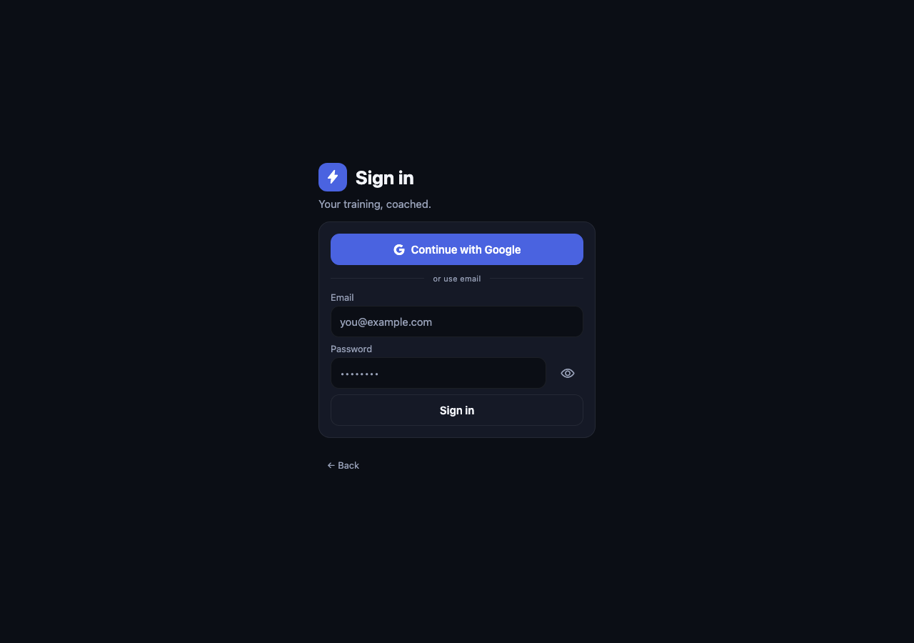

A public marketing/splash page at `/` explains what the app is and links to
sign-in. Native apps (iOS/Android from the same Expo codebase) use the OS
browser for the same OAuth flow.

## Onboarding — first sign-in

On your first sign-in a bottom sheet walks you through connecting data and
the coach:

1. **Connect intervals.icu** — your athlete ID + API key (from
   *intervals.icu → Settings → Developer*). Keys are stored as *hidden*
   PocketBase fields: even you can't read them back through the API; only the
   coach API (server-side) uses them.
2. **Add your OpenRouter key** (BYO) and pick the **coach model**.
3. Optional **athlete profile** — goals and context the coach should know.

Skip any step; everything is editable later in Settings. If you finish without
an OpenRouter key, the coach screen shows a friendly banner
("Add your OpenRouter key in Settings…") instead of a raw error — it clears
the moment a key is saved. The gate is the `onboarded` flag on your user
record plus a local "settings visited" marker, so existing users are never
shown the sheet spuriously.

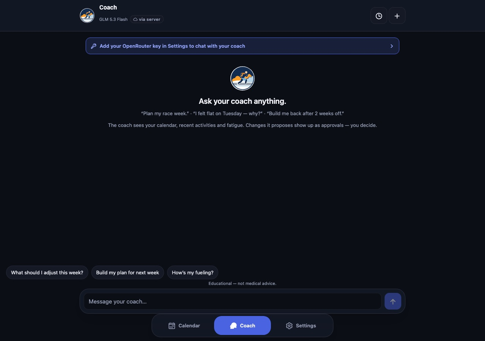

## Calendar — week view (default)

The week view is the home surface: a **hero stats strip** on top, a row of
**day pills** (Mon–Sun, today highlighted, tap to select), and one **day card**
per day. Free navigation backward (history) and forward (plans) with the
arrows; **Today** jumps back.

- The hero strip totals the week: **distance, time, load, form** — actual
  values once recorded, flag-marked planned values before that. Each metric
  has an ⓘ explanation, and Load/Form are tappable → the
  [training status sheet](#hero-stats--training-status-drill-down).
- Each **run card** shows start time, session name, the sport/label chip
  (Intervals, Easy, Long…), and distance · time · load. Status chips: blue
  **PLANNED** for upcoming sessions, green **DONE** once a recorded activity
  matches the plan (reconciliation against intervals.icu activities).
- **Race badges** — events with an intervals.icu race category render as
  **RACE A/B/C** in the race accent color.
- Empty days render as **Rest day**. A refresh button re-syncs; the header
  shows "synced Xm ago" (the Worker also syncs every 6 hours).

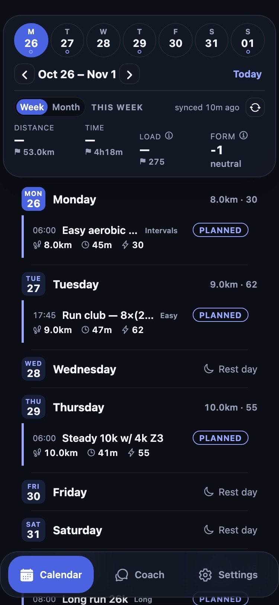
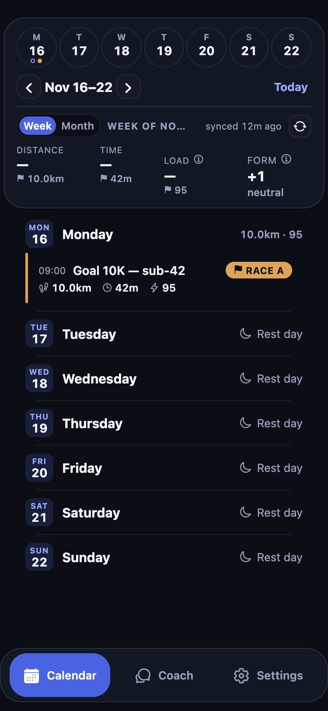
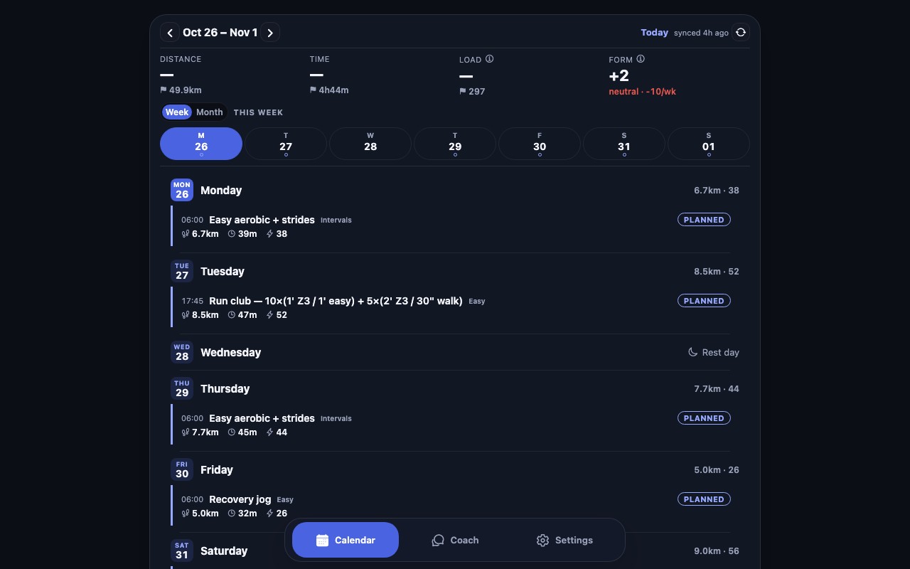

## Calendar — month view + selected-day panel

Toggle **Month** in the hero card for a Mon-first grid. Each day carries a dot
legend: hollow = planned, filled = recorded, orange = race. Tapping a day
selects it and the **selected-day panel** below lists that day's sessions with
the same run cards as the week view (the chevron opens full day detail).

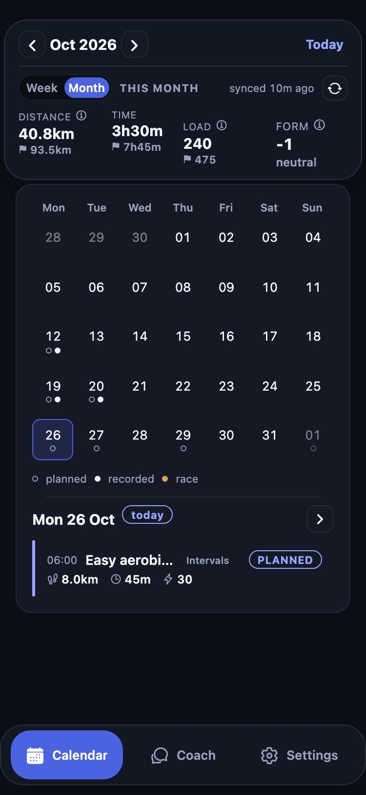

## Day detail

Tap any run card (or a day pill) to peek at the day; **Open full** navigates
to the deep-linkable day route `/calendar/day?date=YYYY-MM-DD` — a page you
can bookmark or open straight from a home-screen widget.

Day detail shows the full workout description (intervals.icu syntax), planned
vs actual, and — once recorded — **actuals** (distance, time, pace, HR, load)
plus a **time-in-zone bar** (Z1…Z5 with minutes per zone). Reconciliation is
visible here too: a planned session that got recorded shows a green
`✓ recorded` badge; one that passed unfulfilled shows **MISSED**.

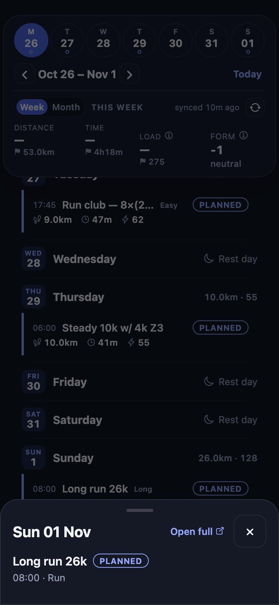
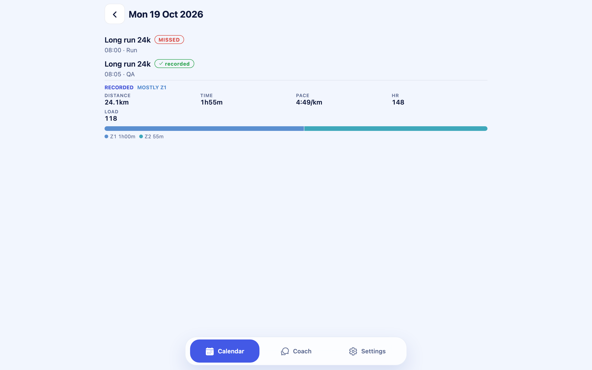

## Hero stats + training status drill-down

The **Load** and **Form** hero metrics open the **"Your training, right now"**
status sheet — a drill-down synthesized from your mirror data:

- **Coach bubble** — one plain-language sentence tying current load, form and
  trend together.
- **THE GAP** — your weekly load vs your *hold-flat* target (the load that
  keeps fitness roughly constant), and the difference.
- **ZONES THIS WEEK** — time-in-zone distribution with an 80/20-style verdict
  (LOW/MOD/HIGH chips flag when the easy/hard mix drifts from the ~75–80%
  easy target).
- **FITNESS** — CTL (fitness) and ATL (fatigue) with week-over-week deltas.
- **RECOVERY · 7-DAY** — HRV, resting HR, and sleep trends.

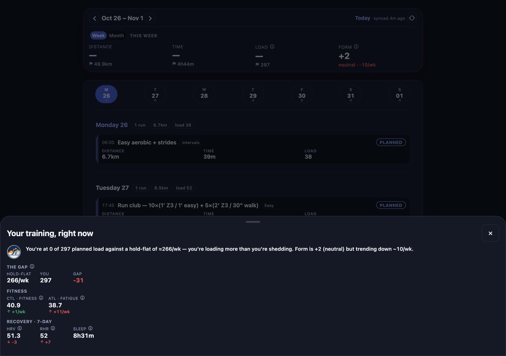
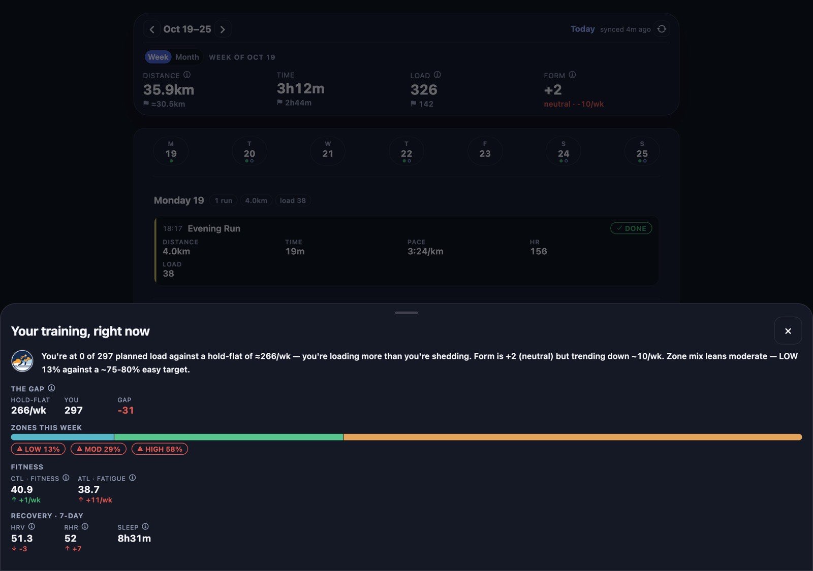

## Coach chat

The **Coach** tab is a grounded chat: it sees your calendar, recent
activities, and fatigue signals (the same mirror data the status sheet uses)
plus a distilled 80/20 knowledge base. Ask "What should I adjust this week?",
"Feedback on last week?", or "I registered for a 10K on Nov 8" — that last
kind of message produces a proposal (next section).

- **Streaming replies** over SSE, rendered as **markdown** (headings, lists,
  tables, emphasis) with typing dots while the first token arrives.
- **Stop** kills a stream mid-reply and keeps the partial text;
  **Retry** re-sends after a failure.
- **Suggested replies** — starter chips under the composer when the thread is
  fresh ("What should I adjust this week?", "Build my plan for next week",
  "How's my fueling?").
- **Sessions** — the clock icon opens chat history: search, switch, rename,
  pin, delete; **New chat** (+) starts a clean thread isolated from the
  current one.
- **Transport badge** — the header chip shows where the model call runs:
  **via server** (the coach Worker, using your saved OpenRouter key) or
  **on-device** (direct from the client when a local key + custom OpenAI-
  compatible base URL are set — LM Studio, Ollama, etc.). Hybrid by design:
  see ADR-0006.
- The footer keeps the standing disclaimer: *Educational — not medical
  advice.* The coach openly states its 80/20 basis and routes injury/health
  red flags to professionals.

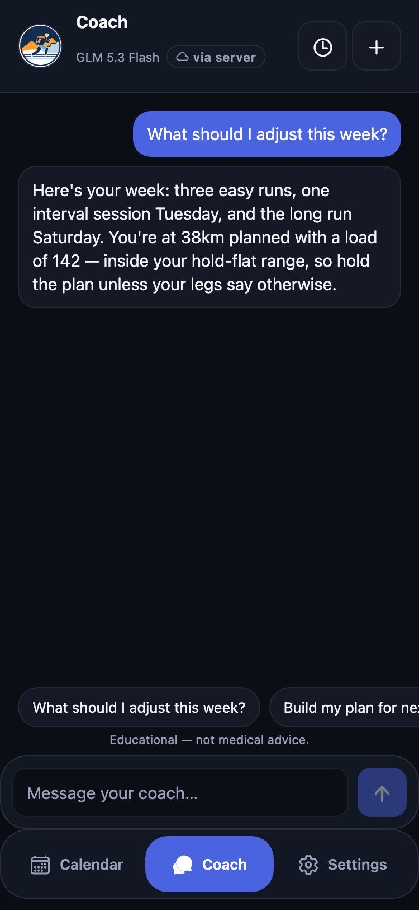
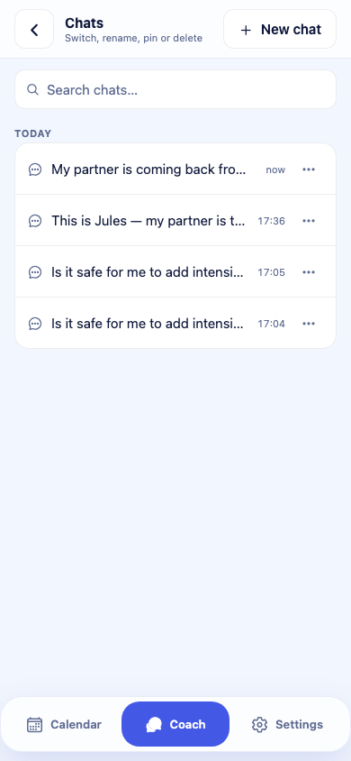

## Proposals — approve every change

Any coach reply that would touch your calendar attaches a **proposal card**
("Add to calendar · pending") and bumps a **pending bar** at the top of the
chat ("N pending proposals to review — tap to open"). Opening one shows
exactly what would change — when, name, category, distance, duration, sport,
and the full workout text with its load profile — plus the coach's rationale.

- **Approve** → the Worker writes the event to intervals.icu *with your API
  key* (as an `EventEx` event, not a workout template), the mirror re-syncs,
  and the calendar updates within seconds. **Dismiss** → nothing happens;
  you can keep chatting to adjust it first.
- On mobile the confirmation is a bottom sheet with the same two buttons.

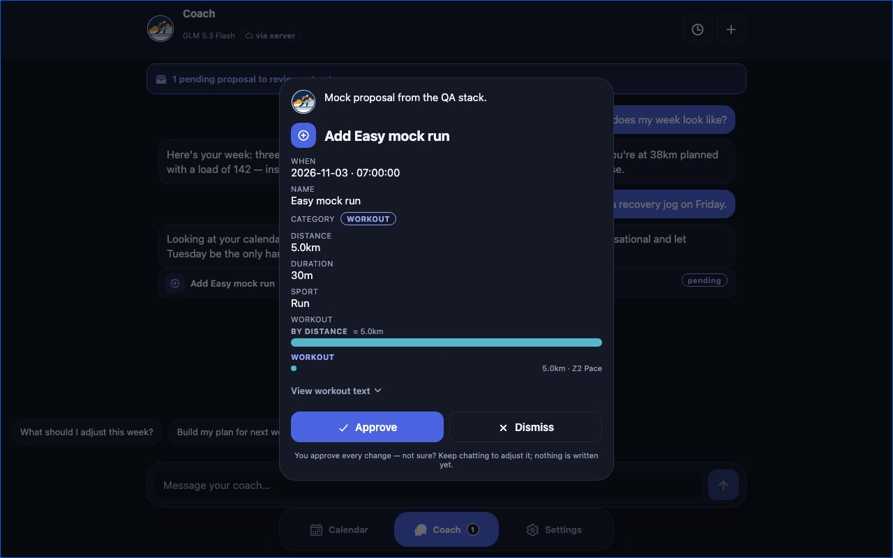
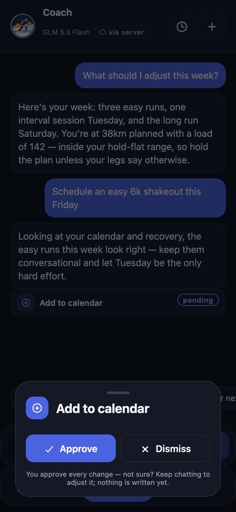

**Bundles** — when one reply changes several related sessions (e.g. "trim my
week ~33%"), the changes arrive as one bundle sheet: each row expands to a
field-level diff with **percentage change bars** (distance, duration…), each
row has a **checkbox**, and you apply with **Approve selected (N)** or walk
away with **Dismiss all**. Partial application is supported — apply two of
three and the remainder regroups; bundle state survives a reload.

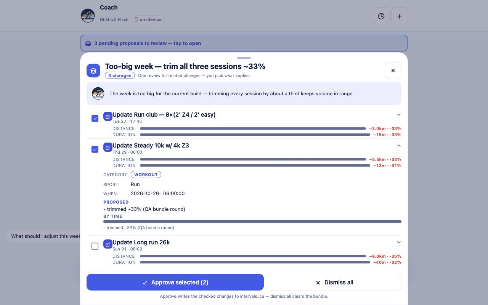

## Settings

Settings covers account, connections, coach preferences, and appearance:

- **Account** — avatar, email, last-updated, and sign-out.
- **intervals.icu connection** — athlete ID, **write-only API key** (blank =
  keep saved; hold the eye to check what you typed), **Test connection**, and
  the current sync status ("ok · synced Xm ago").
- **AI coach** — OpenRouter API key (write-only, BYO — the app ships zero LLM
  credentials), **model picker** with the default badged (GLM 5.3 Flash by
  default; the roster lives in `packages/core` / ADR-0004), and an
  **API base URL** for direct on-device chat against any OpenAI-compatible
  endpoint (OpenRouter default · LM Studio · Ollama · OpenAI).
- **Appearance** — theme override: System / Light / Dark.
- **Units** — km or miles, applied across stats and widgets.
- **Athlete profile** — free-text goals/context (and height) the coach folds
  into every reply; unsaved edits are flagged before you leave.

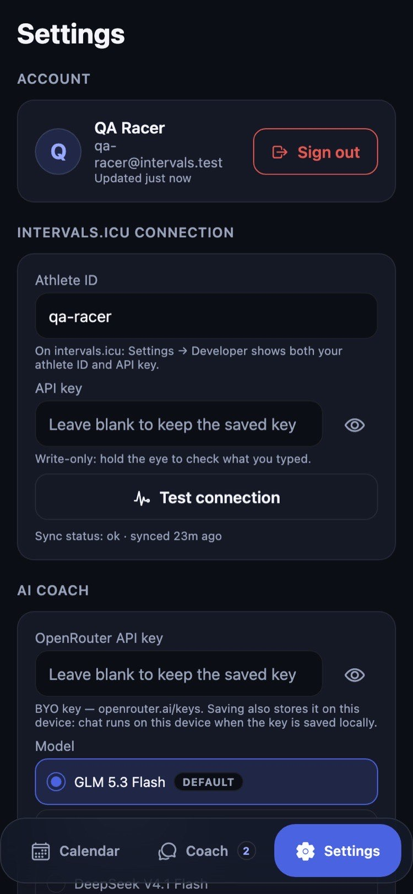

## Themes

Light, dark, and follow-system themes across every surface — the override in
Settings applies app-wide, including widgets. Design language (tokens, type,
motion) is documented in [`design/DESIGN-LANGUAGE.md`](design/DESIGN-LANGUAGE.md).

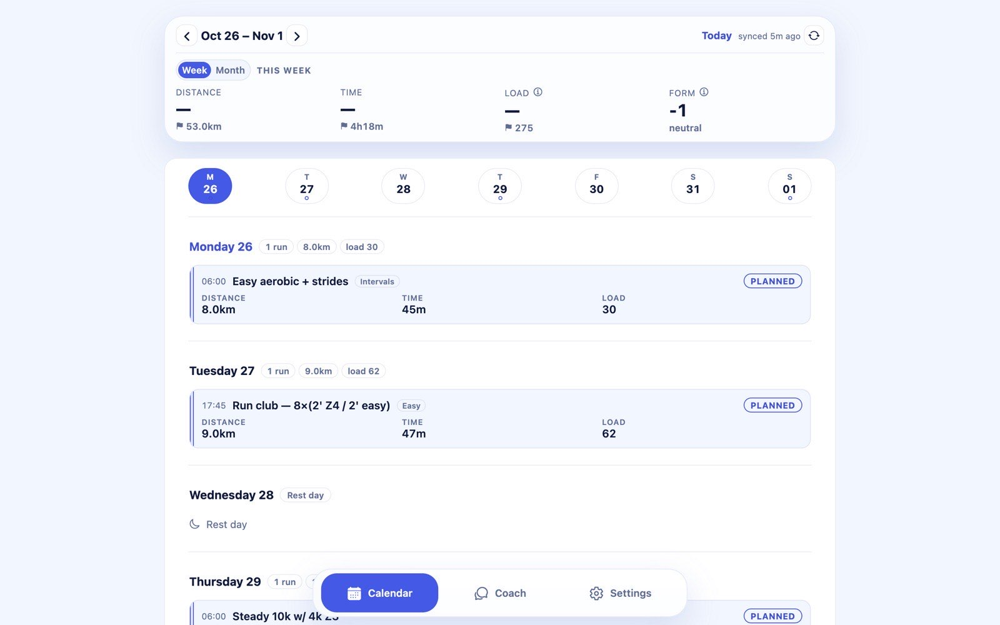
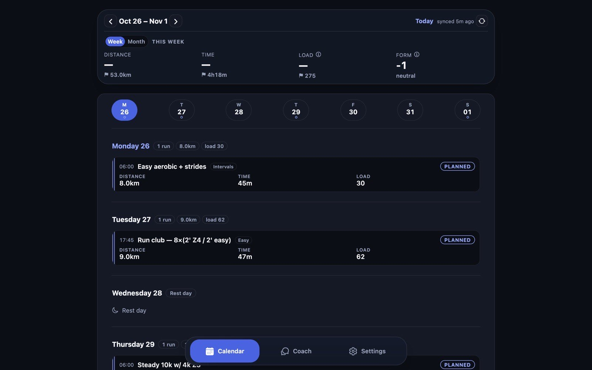

## Home-screen widgets (Android)

Three widget families for the Android home screen, fed by the same snapshot
the app writes on sync (and refreshed 6-hourly by the Worker):

- **Fitness** (2×2 and wide 4×2) — CTL, ATL, form verdict and a 14-day
  fitness sparkline.
- **Upcoming** (4×2 / 4×3) — the next planned sessions with date pills,
  distance/time/load.
- **Next Race** (2×2 and wide 4×1) — countdown days to your next RACE-badged
  event, with an empty state when none is scheduled. Tapping any widget
  deep-links into the calendar.

Add them via the launcher's widget picker (search "intervals"). **iOS**: the
WidgetKit implementation ships in the codebase (`widgets-ios/`) with
simulator QA captures, but iOS builds/distribution are deferred — treat iOS
widgets as coming-soon.

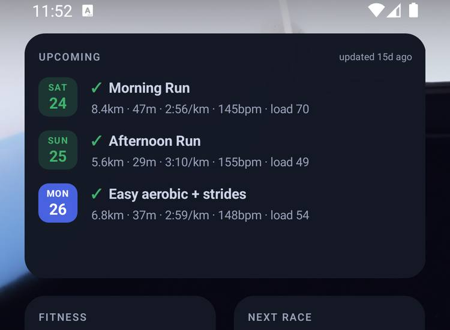
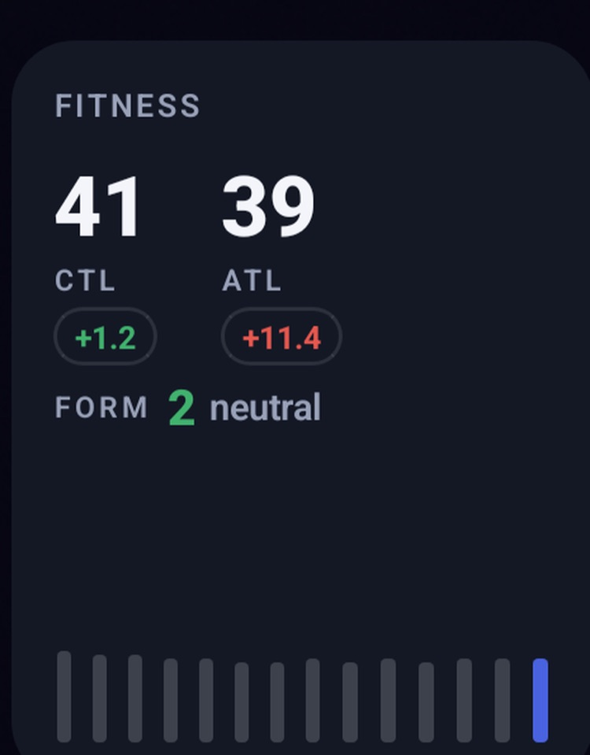
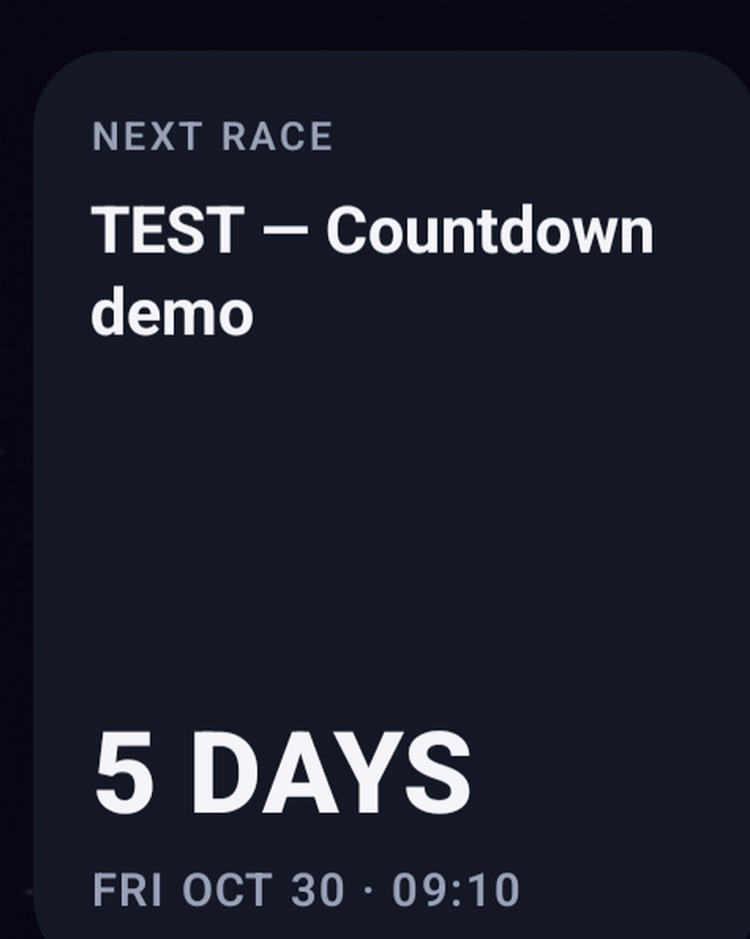
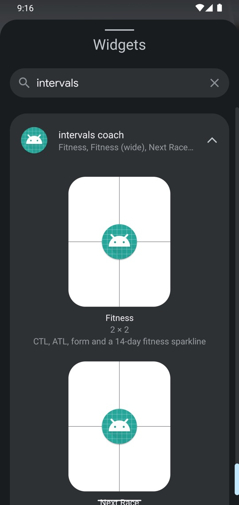

## Deep links

Routes are plain Expo Router URLs, so any surface is reachable from a widget
tap, bookmark, or notification: `/calendar/day?date=YYYY-MM-DD` (day detail),
plus the tab routes (`/calendar`, `/coach`, `/settings`). Widgets use the
`intervals://` scheme to open the calendar.

## Safety model (applies to everything above)

- The AI can **only** propose; the apply path lives solely in the Worker and
  runs only after you tap Approve.
- Your keys (intervals.icu, OpenRouter) are stored hidden on your PocketBase
  record and are read server-side only — never shipped to the client, never
  logged.
- Coaching content is grounded in the distilled 80/20 knowledge base and your
  real data, and is educational — not medical advice.

---

*Under the hood this is a three-plane system (app / data / coach API) with
intervals.icu canonical and PocketBase as a rebuildable mirror — see
[`ARCHITECTURE.md`](ARCHITECTURE.md) and the ADRs in [`adr/`](adr/README.md).*
